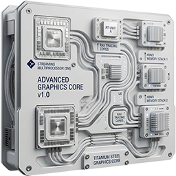
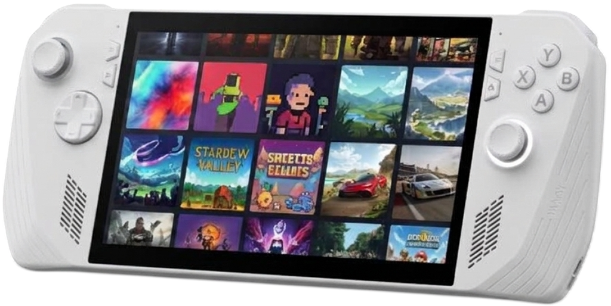
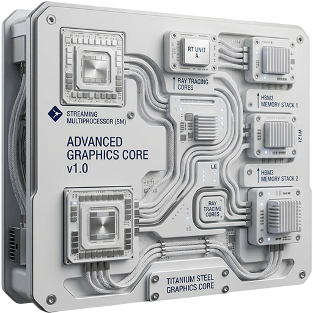
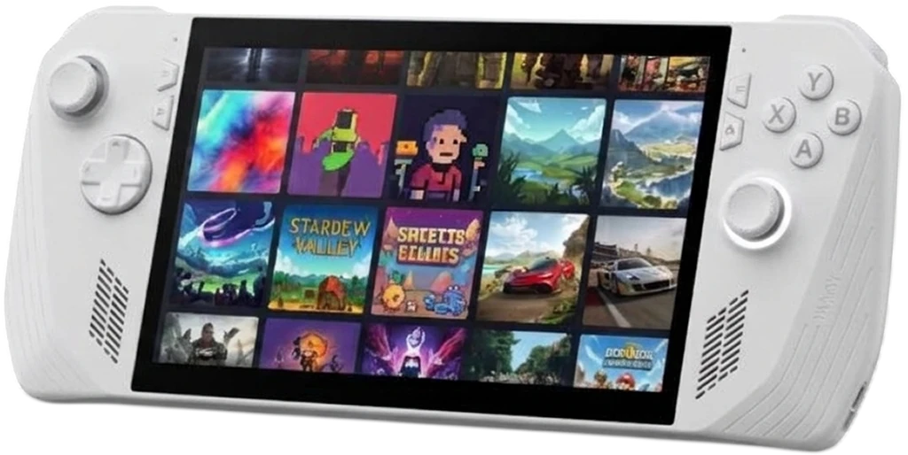
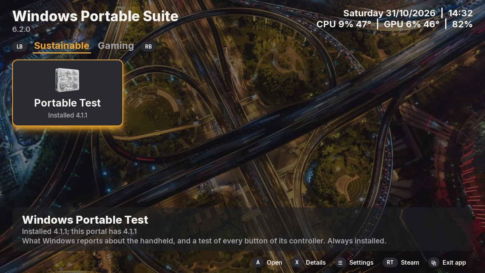
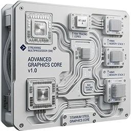
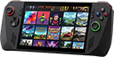
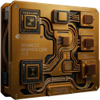

# Icons

The icons of the Windows Portable Suite, and where each is used. Written by the Nexus tools' `make_icons.py`
(`../tools/` in the Nexus checkout the suite is in): change the listing there and run it. The paths are relative to
this repository's root.

## The suite's icon

| Icon | File | Used for |
| --- | --- | --- |
|  | `icons/windows-portable-<size>.png` (1024, 512, 256 and 128 px) | The icon of the Windows Portable Suite, the owner's drawing (26-10-2026): the set its portal's and wiki's copies are made from. |
|  | `icons/windows-portable-white.png` (1024 x 514) | The white handheld, the owner's picture (29-10-2026, cropped to the handheld): the hero of the suite's wiki home, as the board is the BC250 wiki's. |
|  | `apps/test/images/windows-portable-test.webp` (512 px), `-128.png` | Windows Portable Test, the suite's test app: the suite's icon (the test app is the suite's base, as BC-250 Bazzite Test is the BC250 suite's), its window header and window icon, and its Start-menu shortcut. Lossless copies of the drawing, written by this tool. |
|  | `portal/images/windows-portable-suite.webp` (512 px), `-128.png` | The Windows Portable Suite's portal: its window icon and its Start-menu shortcut, and the portal's release in Nexus Release Tool. Lossless copies of the drawing, written by this tool. |
|  | `docs/images/wiki-icon.webp`, `.png` (256 px) | The suite's wiki: the header logo (`.webp`) and the favicon (`.png`), written by this tool. |
|  | `docs/images/home/device.webp` (1024 x 514) | The suite's wiki home: the handheld under the headline, a WebP copy of the owner's white handheld. |
|  | `docs/images/home/portal.webp` (1280 x 720) | The suite's wiki home, One portal for every app: the portal at the Ally's 1280 x 720, rendered offscreen with the suite's apps.toml (Windows Portable Test installed), as WebP. |
|  | `docs/images/apps/<key>.webp` (256 px) | An app's chapter in the suite's wiki: its icon at the top, a WebP copy of the app's drawing. |
|  | `portal/images/apps/<key>.webp` (256 px) | The icon on an app's tile in the portal: Windows Portable Test's is the suite's drawing, written by this tool; another app's is a copy of its own icon. |

## The category icons

Every app but Windows Portable Test has the icon of its category: `icons/<category>/` at 1024, 512,
256 and 128 px (PNG), copied by this tool from the portal's `apps.toml` to the app's `images/<app id>.webp` (512 px)
and `-128.png`, its tile `portal/images/apps/<key>.webp` (256 px) and its chapter's icon `docs/images/apps/<key>.webp`
(256 px). A new picture for a category is converted by `tools/sync_icons.py --suite windows-portable` (the
dashboard's Convert icons), as `icons/categories.toml` says: PNG, the Gaming pictures 2:1.

| Icon | Category | Apps |
| --- | --- | --- |
|  | Gaming: the owner's pictures of the handheld (29-10-2026), wide (2:1: 1024 x 512 down to 128 x 64): the tile and the wiki show them as they are, the window, program and Start-menu icons centered on a transparent square | PCSX2 Manager (`pcsx2`) PPSSPP Manager (`ppsspp`) RPCS3 Manager (`rpcs3`) shadPS4 Manager (`shadps4`) Vita3K Manager (`vita3k`) Xenia Manager (`xenia`) Remote Play (`rplay`) DatStation (`datstat`) Upscale Boost (`upscale`) |
|  | Utilities: the owner's picture of a circuit board (01-11-2026), square (1024 x 1024 down to 128 x 128) | USB HD Cam (`hdcam`) BIOS Reader (`bios`) sFTP Tools (`sftp`) Smart Screen (`smart`) Support Checker (`support`) HD Controller (`hdcontrol`) SSD Check (`ssd`) |

## Material Design icons in the wiki

Drawn by MkDocs Material in the wiki's colors.

| Icon | Name | Used for |
| --- | --- | --- |
|  | `material-stethoscope` | Home: the card "Sustainable". |
|  | `material-gamepad-variant` | Home: the card "Gaming". |
|  | `material-toolbox` | Home: the card "Utilities". |
|  | `material-download` | Home: the Download button. |
